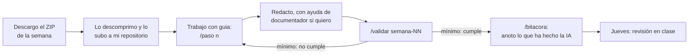

# Diagrama: el ciclo semanal con los agentes

**Cómo leerlo:** cada semana empieza descargando el ZIP de ficheros base y añadiéndolo al repositorio. Se trabaja paso a paso con la guía, se valida la estructura y, si no se cumple el mínimo, se vuelve al trabajo. Cuando se cumple, se anota en la bitácora y se llega a la revisión del jueves.
