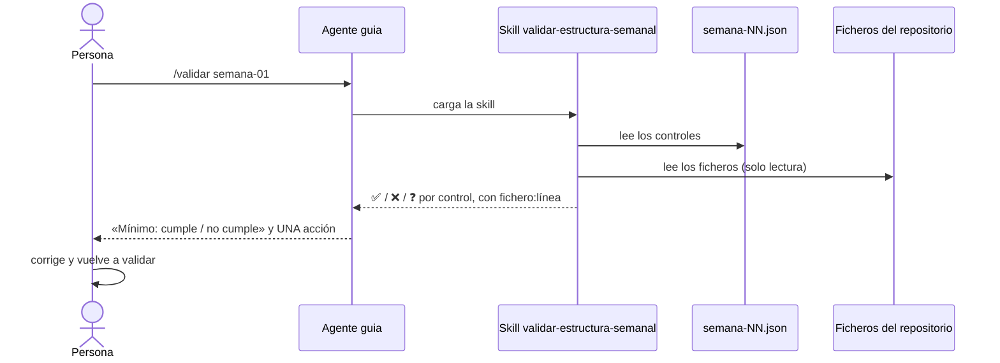

# Diagrama: validación de la estructura semanal

**Cómo leerlo:** la persona pide la validación y la guía carga la skill. La skill lee los controles de la semana y los ficheros, sin modificar nada, y devuelve una lista. La guía resume si se cumple el mínimo y propone **una sola acción**. El mismo conjunto de controles lo ejecuta el script del profesor.

## Qué controla cada tipo de campo

| Campo | Qué se comprueba |
|---|---|
| `ruta` | El fichero existe |
| `rellenado` | El apartado tiene contenido propio, no solo notas guía |
| `tabla` | Columnas, filas, celdas sin vacíos |
| `columna_enlace_fecha` | Enlace (o «no aplica») y fecha AAAA-MM-DD |
| `columna_estado` | `leído` o `sin leer` |
| `mermaid` | Hay un diagrama |
