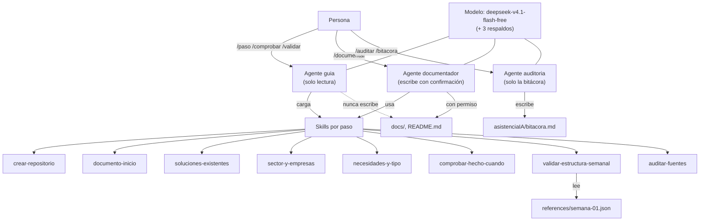

# Esquema de agentes vigente

**Vigente desde 2026-11-16 (semana 1)** · Foto de este momento: [esquemas/semana-01.md](esquemas/semana-01.md) · Versiones y cambios: [.opencode/MANIFIESTO.md](../.opencode/MANIFIESTO.md) y [.opencode/CHANGELOG.md](../.opencode/CHANGELOG.md)

**Cómo leerlo:** la persona habla con uno de los tres agentes. `guia` solo lee y acompaña; `documentador` escribe la documentación (`docs/` y `README.md`) con confirmación; `auditoria` escribe solo la bitácora. Las skills son los procedimientos que cargan; `validar-estructura-semanal` lee la especificación de la semana. La línea de puntos indica lo que `guia` **no** puede hacer.

## Piezas y versiones

| Tipo | Nombre | Versión |
|---|---|---|
| agente | guia | 0.4.0 |
| agente | documentador | 0.3.0 |
| agente | auditoria | 0.1.0 |
| skill | crear-repositorio | 0.2.1 |
| skill | documento-inicio, soluciones-existentes, sector-y-empresas, necesidades-y-tipo, comprobar-hecho-cuando, auditar-fuentes | 0.1.0 |
| skill | validar-estructura-semanal | 0.2.0 |
| comando | paso, comprobar, documentar, validar | 0.1.0 |
| comando | auditar | 0.1.0 |
| comando | bitacora | 0.2.0 |

## Permisos de cada agente

| Acción | `guia` | `documentador` | `auditoria` |
|---|---|---|---|
| Leer ficheros | sí (`.env` no) | sí (`.env` no) | sí (`.env` no) |
| Editar `docs/` y `README.md` | **no** | **con confirmación** | no |
| Editar `asistenciaIA/bitacora.md` | no | no | **sí** |
| Editar cualquier otro sitio | no | no | no |
| `git status`, `git diff`, `git log`, `ls` | sí | sí | sí (sin `ls`) |
| `git push`, `git reset`, `rm` | no | no | no |
| Abrir una web | pregunta | pregunta | no |
