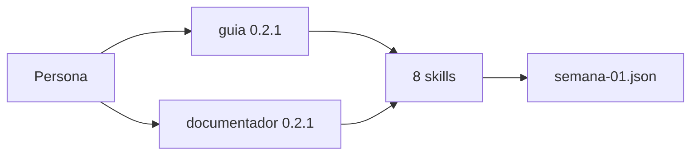

# Esquema de agentes · semana 1 (2026-11-16)

> **Foto fija: no se edita.** Cada semana se crea un fichero nuevo. El esquema vigente está en [../esquema-agentes.md](../esquema-agentes.md).

| Pieza | Versión | Qué hace |
|---|---|---|
| Agente `guia` | 0.2.1 | Acompaña paso a paso. Solo lectura |
| Agente `documentador` | 0.2.1 | Da forma de documentación; escribe en `docs/`, `README.md` y `asistenciaIA/` con confirmación |
| Skill `crear-repositorio` | 0.2.1 | Paso 0: repositorio público, README y ficheros base del ZIP |
| Skills de paso | 0.1.0 | `documento-inicio`, `soluciones-existentes`, `sector-y-empresas`, `necesidades-y-tipo` |
| Skills de control | 0.1.0 | `comprobar-hecho-cuando`, `validar-estructura-semanal`, `auditar-fuentes` |
| Comandos | 0.1.0 | `/paso`, `/comprobar`, `/documentar`, `/validar`, `/bitacora` |

**Modelo:** `opencode/deepseek-v4.1-flash-free`. **Respaldos (cambio manual):** `opencode/glm-5.3-flash-free`, `opencode/minimax-m3.1-flash-free`, `opencode/hy4-flash-free`.
**Especificación de validación:** `semana-01.json` (0.2.0).
**OpenCode:** 2.2.6.

**Cómo leerlo:** la persona usa uno de los dos agentes; ambos cargan las skills y la de validación lee la especificación de la semana 1.
