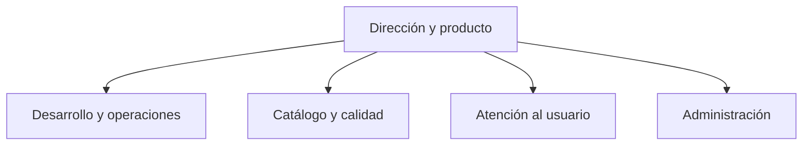

# 01 · Análisis y documentación inicial de CardLab_TCG (RA1)

## 1. Sector y empresas (CE 1a, 1b)

CardLab pertenece al ámbito de los juegos de cartas coleccionables (TCG). Está pensado para quien guarda cartas físicas y quiere saber cuáles puede usar en un mazo. En este sector conviven empresas que editan juegos, fabricantes de accesorios y proveedores de aplicaciones para gestionar colecciones. En España, una tienda especializada cuya actividad principal sea la venta minorista de juegos y juguetes encaja en la clase 47.64 de la CNAE-2025 (47.65 en la CNAE-2009). Esta referencia sectorial corresponde al comercio minorista. Para clasificar una empresa que explotase CardLab habría que determinar primero su actividad principal. [CNAE-2025](https://www.boe.es/eli/es/rd/2025/01/14/10) y [CNAE-2009](https://www.boe.es/eli/es/rd/2007/04/13/475) · 2026-11-19 · sin leer.

En ambos documentos, la fecha indica cuándo consultó la fuente la IA. El campo «Estado» recoge la lectura personal del alumno. [Declaración de uso de IA](declaracion-uso-ia.md).

| Empresa | Tamaño | Forma u organización | Ámbito | Producto o servicio | Fuente y fecha de acceso | Estado |
|---|---|---|---|---|---|---|
| The Pokémon Company | Sin verificar | Grupo con sede en Japón y sociedades en varios países | Internacional | Desarrolla el juego de cartas Pokémon y gestiona licencias de la marca. | [Perfil corporativo](https://corporate.pokemon.co.jp/en/aboutus/company/) · 2026-11-13 | sin leer |
| Wizards of the Coast | Sin verificar | Conjunto de estudios especializados | Juegos físicos y digitales | Desarrolla juegos de cartas coleccionables, juegos de rol y videojuegos. | [Presentación de la empresa](https://company.wizards.com/en) · 2026-11-13 | sin leer |
| Bandai Namco Holdings | Sin verificar | Grupo organizado en unidades de negocio | Juguetes y entretenimiento | Su unidad Toys and Hobby incluye los juegos de cartas de Bandai. | [Grupo](https://www.bandainamco.co.jp/en/about/) y [unidad Toys and Hobby](https://www.bandainamco.co.jp/group/en/toyandhobby.php) · 2026-11-13 | sin leer |
| Arcane Tinmen ApS | Sin verificar | Sociedad danesa titular de Dragon Shield | Accesorios y servicios digitales | Comercializa fundas y álbumes y ofrece aplicaciones para registrar cartas. | [Condiciones](https://www.dragonshield.com/pages/terms-conditions) y [preguntas frecuentes](https://www.dragonshield.com/en-eu/pages/faqs) · 2026-11-13 | sin leer |
| Collectr Inc. | Sin verificar | Sociedad con sede en Canadá | Aplicación y web para coleccionistas de varios juegos | Permite catalogar una colección y seguir la evolución de su valor. | [Condiciones](https://www.getcollectr.com/terms-and-conditions) y [producto](https://getcollectr.com/) · 2026-11-13 | sin leer |

**Agrupación.** The Pokémon Company, Wizards of the Coast y Bandai Namco participan en la creación y edición de juegos. Arcane Tinmen combina la conservación de las cartas físicas con su gestión digital. Collectr se especializa en el seguimiento de colecciones.

**Empresa tipo.** Collectr es la referencia más cercana a CardLab por el uso que propone al coleccionista. A partir de su oferta se deduce el siguiente reparto de tareas para una empresa de este tipo. La estructura interna de Collectr sigue sin verificarse.

| Área | Función |
|---|---|
| Dirección y producto | Decide qué necesidades atender en la siguiente versión y acuerda las prioridades con desarrollo. |
| Desarrollo y operaciones | Mantiene la aplicación y la base de datos. Gestiona los accesos, el despliegue y las copias de seguridad. |
| Catálogo y calidad | Distingue las ediciones de una carta y comprueba los identificadores. Comunica a desarrollo los duplicados y los errores de recuento. |
| Atención al usuario | Recoge incidencias. Si dos cartas aparecen como una sola, solicita los datos de la edición y traslada el caso a catálogo. |
| Administración | Revisa las condiciones de los proveedores de datos y controla los costes del servicio. |

## 2. Necesidades y oportunidades (CE 1c, 1d)

**Criterio de prioridad.** El orden sigue la tarea que el usuario quiere resolver. Primero necesita identificar las cartas, registrar cuántas tiene y preparar un mazo. Con esos datos puede calcular qué le falta. El escaneo y la compra externa son mejoras opcionales según la [propuesta inicial](00-documentoInicio.md).

| Prioridad | Necesidad | Fuente y fecha de acceso | Razón del puesto |
|---|---|---|---|
| 1 | Distinguir cartas con el mismo nombre y distinta edición. | [Pokéllector](https://www.pokellector.com/) · 2026-11-13 · sin leer | Un error de identificación al registrar una carta se arrastra al inventario y al mazo. |
| 2 | Consultar cuántas copias hay en el inventario personal. | [Collectr](https://getcollectr.com/) y [documento inicial](00-documentoInicio.md) · 2026-11-13 · sin leer | Es el dato que permite consultar la colección sin abrir las cajas. |
| 3 | Preparar y modificar una lista de cartas con sus cantidades. | [Constructor de Limitless](https://my.limitlesstcg.com/) · 2026-11-13 · sin leer | La lista determina cuántas copias se necesitan de cada carta. |
| 4 | Comparar el mazo con el inventario personal. | [Preguntas frecuentes de Dragon Shield](https://www.dragonshield.com/en-eu/pages/faqs) · 2026-11-13 · sin leer | Es la aportación principal del proyecto y requiere los tres pasos anteriores. |
| 5 | Agilizar el registro inicial mediante la cámara del móvil. | [Collectr](https://getcollectr.com/) · 2026-11-13 · sin leer | Reduce el trabajo de introducción. Para la primera versión basta la búsqueda manual. |
| 6 | Localizar en un mercado externo las copias que faltan. | [Documento inicial](00-documentoInicio.md) · 2026-11-13 · sin leer | Solo resulta útil después de obtener una lista fiable de cartas que faltan. |

**Dato cuantitativo.** A finales de marzo de 2026, la producción mundial acumulada del juego de cartas Pokémon superaba los **85 000 millones de cartas**. La cifra se recuperó del texto indexado de la página oficial. Queda pendiente que el alumno compruebe el contador en la página. [The Pokémon Company, «Pokémon in Figures»](https://corporate.pokemon.co.jp/en/aboutus/figures/) · 2026-11-13 · sin leer.

**Oportunidad.** Una misma persona puede querer completar una colección y preparar un mazo con las copias que ya tiene. CardLab propone resolver ambas tareas con un solo inventario. La cifra de producción da una referencia de la escala del juego. Para estimar la demanda en España haría falta saber cuántos jugadores tienen ese problema y cómo lo resuelven. Una primera comprobación consistiría en comparar el tiempo y los errores al preparar el mismo mazo con las cajas y con el inventario digital.

## 3. Tipo de proyecto elegido (CE 1e)

La solución elegida es una **aplicación web a medida** con un catálogo compartido, un inventario por cuenta y un constructor de mazos. Los costes y los tiempos de la tabla son estimaciones relativas para el proyecto académico.

| Opción | Coste previsto | Tiempo previsto | Encaje con los módulos de 2.º de DAW |
|---|---|---|---|
| Aplicación web a medida | Medio. Requiere un servidor y una base de datos. | Medio-alto. Hay que desarrollar las cuentas, el inventario y el constructor. | Alto en desarrollo en entorno servidor (0613), despliegue (0614) y diseño de interfaces (0615). |
| Hoja de cálculo | Bajo. Calc es gratuito. | Bajo para un inventario individual con fórmulas. | Permite trabajar el recuento, pero apenas cubre el acceso por cuenta y el despliegue web. |
| Aplicación móvil nativa | Depende de la distribución y del entorno de pruebas. | Alto. Añade el desarrollo y las pruebas en una plataforma móvil. | Encaja con el uso de la cámara, aunque el escaneo es opcional y la interfaz prevista es web. |
| Integración de servicios existentes | Pendiente de las condiciones de acceso a los datos. | Incierto hasta conocer las interfaces disponibles. | Permitiría trabajar la integración en el servidor. El inventario y el constructor dependerían de servicios externos. |

La web permite guardar un mazo incompleto y consultar las copias que faltan desde un navegador. La hoja de cálculo deja las fórmulas a cargo del usuario. La aplicación nativa exige invertir tiempo en una función opcional. En la integración externa aún habría que verificar el acceso al catálogo y los permisos de uso. Se propone Pokémon TCG como primer juego para acotar el catálogo. Esta elección queda pendiente de validación. Las opciones de implementación se comparan en el [estado del arte](01b-sota.md).

## 4. Objetivos, requisitos y restricciones (CE 1f)

| ID | Objetivo | Medida de aceptación propuesta |
|---|---|---|
| OBJ-01 | Consultar y mantener el inventario personal. | Completar diez búsquedas de referencia, modificar cantidades y recuperar el inventario al iniciar otra sesión. |
| OBJ-02 | Preparar un mazo y saber cuántas copias faltan de cada carta. | Crear, editar, guardar y eliminar un mazo. Obtener el resultado esperado en los cinco casos de RF-07. |
| OBJ-03 | Proteger los datos de cada cuenta y facilitar su consulta y recuperación. | Superar las cinco comprobaciones RNF de acceso, contraseñas, tiempo de respuesta, uso de la interfaz y restauración. |
| OBJ-04 | Entregar una primera versión reproducible dentro del plazo y del alcance acordados. | Instalar el prototipo a partir de su guía y completar las comprobaciones REST con los datos de demostración. |

El recuento se hará **por edición y por mazo**. Guardar una lista conserva intactas las existencias. Así, una misma colección puede compararse con varios mazos alternativos. Los criterios siguientes se comprobarán durante el desarrollo.

| ID | Requisito | Tipo | Cómo se verifica |
|---|---|---|---|
| RF-01 | Crear una cuenta e iniciar y cerrar sesión. | Funcional | Registrar un alias, intentar repetirlo y probar una contraseña correcta y otra incorrecta. Al cerrar la sesión debe bloquearse el acceso al inventario. |
| RF-02 | Buscar cartas por nombre y filtrar por colección. | Funcional | Preparar diez búsquedas sobre cien registros, incluida una sin coincidencias. Comparar las listas obtenidas con las esperadas. |
| RF-03 | Mostrar el identificador, el nombre, la colección y el número de cada carta. | Funcional | Buscar dos ediciones con el mismo nombre y comprobar que se distinguen en los resultados. |
| RF-04 | Añadir, modificar y retirar copias del inventario. | Funcional | Registrar tres copias, cambiar la cantidad a dos y retirar la entrada. Comprobar que se rechazan números negativos, decimales y texto. |
| RF-05 | Conservar el inventario entre sesiones. | Funcional | Guardar las cantidades, reiniciar la aplicación y volver a entrar con la misma cuenta. Deben recuperarse las mismas cartas y cantidades. |
| RF-06 | Crear, consultar, editar y borrar mazos. | Funcional | Guardar un mazo y abrirlo de nuevo. Añadir una segunda copia de la misma edición aumenta su cantidad en una sola línea. Ponerla a cero elimina la línea. Borrar el mazo lo retira de la cuenta. |
| RF-07 | Mostrar cuántas copias exige el mazo, cuántas se poseen y cuántas faltan. | Funcional | Probar los pares «necesarias/registradas» 4/0, 4/2, 4/4, 4/6 y 1/0. Deben faltar, respectivamente, 4, 2, 0, 0 y 1 copias. |
| RF-08 | Actualizar la comparación al cambiar el inventario. | Funcional | Si un mazo pide cuatro copias y el usuario pasa de dos a tres, al abrirlo de nuevo debe faltar una. Editar el mazo debe conservar el inventario. |
| RNF-01 | Restringir el acceso a los inventarios y mazos según la cuenta. | No funcional | Con dos cuentas de prueba, comprobar que el servidor impide consultar, editar o borrar datos de la otra cuenta. |
| RNF-02 | Proteger las contraseñas mediante una función de derivación adaptativa con sal individual. | No funcional | Revisar la configuración y comprobar que dos cuentas con la misma contraseña guardan valores distintos. Verificar que las respuestas y los registros omiten las contraseñas. |
| RNF-03 | Mantener el percentil 95 del tiempo de respuesta por debajo de dos segundos en la prueba local. | No funcional | Usar 1000 cartas, 500 entradas de inventario, diez mazos de 60 cartas y un usuario. Para cada operación (buscar y consultar qué falta), hacer 20 peticiones previas y medir las 100 siguientes. Anotar el equipo utilizado. |
| RNF-04 | Permitir buscar una carta, cambiar su cantidad y consultar qué falta con el teclado y en una pantalla móvil. | No funcional | Recorrer las tres tareas con teclado y foco visible. A 360 y 1280 píxeles de ancho deben estar disponibles todos los controles. Las cantidades que faltan deben poder identificarse sin depender del color. |
| RNF-05 | Recuperar el inventario y los mazos desde una copia de seguridad. | No funcional | Restaurar la copia en otra base de datos y comparar propietarios, cartas y cantidades. |
| REST-01 | Entregar un catálogo, cuentas, inventarios y un constructor que indique qué cartas faltan. | Restricción | Completar RF-01 a RF-08 con el escaneo y los enlaces de compra desactivados. |
| REST-02 | Utilizar datos ficticios en las pruebas y en la demostración. | Restricción | Revisar las cuentas, las capturas, las exportaciones y los registros que se vayan a compartir. |
| REST-03 | Entregar H1 el 26 de noviembre de 2026 y disponer de la primera versión funcional antes del 31 de marzo de 2027. | Restricción | Comprobar la entrega de H1 y fechar la demostración de la primera versión. |
| REST-04 | Documentar la procedencia y los permisos de los recursos externos. | Restricción | Identificar la fuente, las condiciones y la fecha de consulta de cada recurso. Usar material propio de prueba cuando falte el permiso necesario. |
| REST-05 | Permitir la instalación con datos de prueba sin contratar un servicio de pago. | Restricción | Seguir la guía en una instalación limpia y comprobar que se pueden consultar el catálogo, el inventario y un mazo. |

### Matriz de trazabilidad

| Objetivo | Requisitos relacionados |
|---|---|
| OBJ-01 · Consultar y mantener el inventario | RF-01, RF-02, RF-03, RF-04 y RF-05 |
| OBJ-02 · Preparar mazos y calcular las copias que faltan | RF-06, RF-07 y RF-08 |
| OBJ-03 · Proteger, consultar y recuperar los datos | RNF-01, RNF-02, RNF-03, RNF-04 y RNF-05 |
| OBJ-04 · Entregar una versión reproducible | REST-01, REST-02, REST-03, REST-04 y REST-05 |

## 5. Obligaciones fiscales, laborales y de prevención (CE 1g)

CardLab se plantea como un encargo académico simulado, con cuentas de prueba y sin cobros ni personal contratado. La tabla recoge las condiciones que habría que estudiar si en el futuro un autónomo o una sociedad explotara el servicio en España.

| Obligación | Condición de aplicación | Norma consultada el 2026-11-13 | Estado |
|---|---|---|---|
| Alta censal | Quien inicie una actividad empresarial o profesional deberá presentar la declaración de alta en los términos previstos para el comienzo de la actividad. | [RD 1065/2007, art. 9](https://www.boe.es/eli/es/rd/2007/07/27/1065/con) | sin leer |
| IVA y facturación | Si se cobran servicios, habrá que determinar dónde tributa la operación, si está sujeta al IVA y cuándo procede expedir factura. | [Ley 37/1992, arts. 4 y 5](https://www.boe.es/eli/es/l/1992/12/28/37/con) y [RD 1619/2012, arts. 2 y 6](https://www.boe.es/eli/es/rd/2012/11/30/1619/con) | sin leer |
| Tributación de los rendimientos | Un empresario individual declararía los rendimientos de su actividad en el IRPF. Una sociedad española sujeta al impuesto sobre sociedades tributaría por este último. | [Ley 35/2006, art. 27](https://www.boe.es/eli/es/l/2006/11/28/35/con) y [Ley 27/2014, art. 7](https://www.boe.es/eli/es/l/2014/11/27/27/con) | sin leer |
| Trabajo por cuenta propia | Quien ejerza de forma habitual, personal y directa una actividad lucrativa por cuenta propia deberá comprobar su inclusión en el régimen especial de trabajadores autónomos. | [Ley General de la Seguridad Social, art. 305](https://www.boe.es/eli/es/rdlg/2015/10/30/8/con) | sin leer |
| Contratación y Seguridad Social | Si se contrata personal, habrá que tramitar las altas, cotizar, formalizar los contratos según su modalidad, aplicar el convenio correspondiente y registrar la jornada. | [Ley General de la Seguridad Social, arts. 18 y 139](https://www.boe.es/eli/es/rdlg/2015/10/30/8/con) y [Estatuto de los Trabajadores, arts. 8, 34.9 y 82](https://www.boe.es/eli/es/rdlg/2015/10/23/2/con) | sin leer |
| Prevención de riesgos laborales | Con personal contratado, la empresa debe evaluar los riesgos y planificar medidas preventivas. En los puestos con uso habitual de pantallas, la evaluación debe considerar la vista, la postura y la carga mental. | [Ley 31/1995, arts. 14 a 16](https://www.boe.es/eli/es/l/1995/11/08/31/con) y [RD 488/1997, arts. 2 y 3 y anexo](https://www.boe.es/eli/es/rd/1997/04/14/488/con) | sin leer |

Si en el futuro se abriera el registro a personas reales, habría que identificar los datos personales tratados, justificar para qué se necesitan, determinar la base jurídica e informar a los usuarios. En la demostración se utilizarán cuentas ficticias, conforme a REST-02. [RGPD, arts. 5, 6 y 13](https://www.boe.es/doue/2016/119/L00001-00088.pdf) · 2026-11-19 · sin leer.

## 6. Ayudas y subvenciones (CE 1h)

**Cheques de Innovación y Desarrollo Empresarial 2026 de la Agencia SEKUENS.** La línea de digitalización sirve para estudiar cómo podría financiarse la implantación de una herramienta de gestión en una empresa asturiana que cumpliera las condiciones de la convocatoria.

| Campo | Condiciones de la convocatoria |
|---|---|
| Identificación | Resolución de 12 de marzo de 2026, extracto publicado en el BOPA el 25 de marzo. Código BDNS 894180. |
| Solicitantes | Pymes y empresarios individuales con centro de trabajo y actividad elegible en Asturias. Para las pymes se exige al menos una persona trabajadora a jornada completa o equivalente. |
| Actuación | Servicio de una empresa de consultoría TIC para desarrollar o implantar una solución de digitalización. Se excluyen el hardware y las licencias. El proyecto debe comenzar después de la solicitud. |
| Cuantía para pymes | 2500 € de ayuda para proyectos de 5000 a menos de 10 000 €. Para proyectos de 10 000 a 15 000 €, la ayuda es de 5000 €. |
| Cuantía para empresarios individuales | 1250 € de ayuda para proyectos de 2500 a menos de 5000 €. Para proyectos de 5000 a 15 000 €, la ayuda es de 2500 €. |
| Plazo y solicitud | La convocatoria cerró el 30 de abril de 2026 a las 14:00, hora peninsular. La solicitud se presentaba por vía electrónica con los datos generales, la memoria y la declaración de ausencia de conflicto de intereses. |

La ayuda cubriría, en su caso, una contratación externa admisible. El trabajo del alumno en el prototipo queda fuera de ese supuesto. Fuentes oficiales consultadas el 2026-11-13, pendientes de lectura personal (`sin leer`). [Convocatoria completa](https://www.idepa.es/documents/20147/76120/1.9.Convocatoria_Cheques_2026.pdf/f58f9ee0-40c7-89d7-cad5-8c1cb334d8a6) · [Extracto del BOPA](https://www.idepa.es/documents/20147/76120/1.9.Extracto_Convocatoria_Cheques_2026.pdf/857faa5b-949b-cf8e-2dae-5046904cff05) · [Bases reguladoras](https://www.idepa.es/documents/20147/76120/1.9.Bases_Reguladoras_I%2BD%2Bi.pdf/03574821-4406-42a5-4c82-5fc9f4417bc0).

## 7. Guion de trabajo (CE 1i)

La hoja de H1 fija la entrega del anteproyecto y el documento de inicio sitúa la primera versión funcional antes del 31 de marzo. Para las demás fases se toman las fechas del ejemplo de la guía H1-D. Son provisionales hasta cotejarlas con el calendario del centro.

| Fase | Periodo | Tarea principal | Responsable | Entregable o hito |
|---|---|---|---|---|
| 1. Análisis | Del 12 al 26 de noviembre de 2026 | Comparar soluciones, definir los requisitos y contrastar las fuentes. | Alumno. El tutor revisa el PR. | **H1 · 26 de noviembre de 2026.** |
| 2. Diseño | Del 26 de noviembre al 10 de diciembre de 2026 | Definir cómo se identifican las cartas y cómo se relacionan las cuentas, los inventarios y los mazos. | Alumno | Modelo de datos y diseño de pantallas. |
| 3. Planificación | Del 10 de diciembre de 2026 al 21 de enero de 2027 | Estimar el trabajo, ordenar las tareas y prever qué hacer si el catálogo externo resulta inaccesible. | Alumno | **H2 · 21 de enero de 2027 (provisional).** |
| 4. Implementación | Del 21 de enero al 31 de marzo de 2027 | Desarrollar el catálogo, las cuentas y el constructor vinculado al inventario. | Alumno | Primera versión funcional. |
| 5. Pruebas | Del 1 al 23 de abril de 2027 | Comprobar los recuentos, el acceso por cuenta y la restauración de datos. | Alumno | Resultados de las pruebas y correcciones. |
| 6. Despliegue | Del 26 de abril al 7 de mayo de 2027 | Instalar la aplicación y reproducir la demostración siguiendo la guía. | Alumno | **H3 · 7 de mayo de 2027 (provisional).** |
| 7. Seguimiento y cierre | Seguimiento semanal hasta el cierre, el 18 de junio de 2027 | Registrar avances y bloqueos, cerrar la memoria y preparar la defensa. | Alumno | Memoria y defensa. |

**Entrega de H1.** El tutor revisa el avance el 19 de noviembre. A partir de esa fecha, cada solicitud de integración (PR) lleva la etiqueta `necesita-tutor` y requiere aprobación. El 23 de noviembre es el último día recomendado para abrir el PR de entrega y el 25 es el último día para integrarlo. El alumno debe subir la etiqueta `h1` y comunicar el identificador de la revisión al tutor antes de las 23:59 del día 26.

## 8. Glosario

| Término | Definición en CardLab | Sinónimos que se evitan |
|---|---|---|
| Catálogo | Lista común de cartas y ediciones que pueden buscarse y añadirse a una cuenta. | Almacén general, inventario global. |
| Inventario personal | Registro de las copias físicas que una persona declara tener de cada edición. | Almacén, stock del usuario. |
| Mazo | Lista guardada de cartas y cantidades que una persona quiere reunir para jugar. Puede contener cartas que todavía le faltan. | Baraja, deck. |
| Copias que faltan | Diferencia positiva entre la cantidad de una edición que pide el mazo y la que figura en el inventario. Si hay suficientes copias, el resultado es cero. | Déficit, pendientes de compra. |
| Mercado externo | Plataforma de terceros a la que se podría dirigir al usuario para buscar una carta. | Marketplace, tienda de CardLab. |
